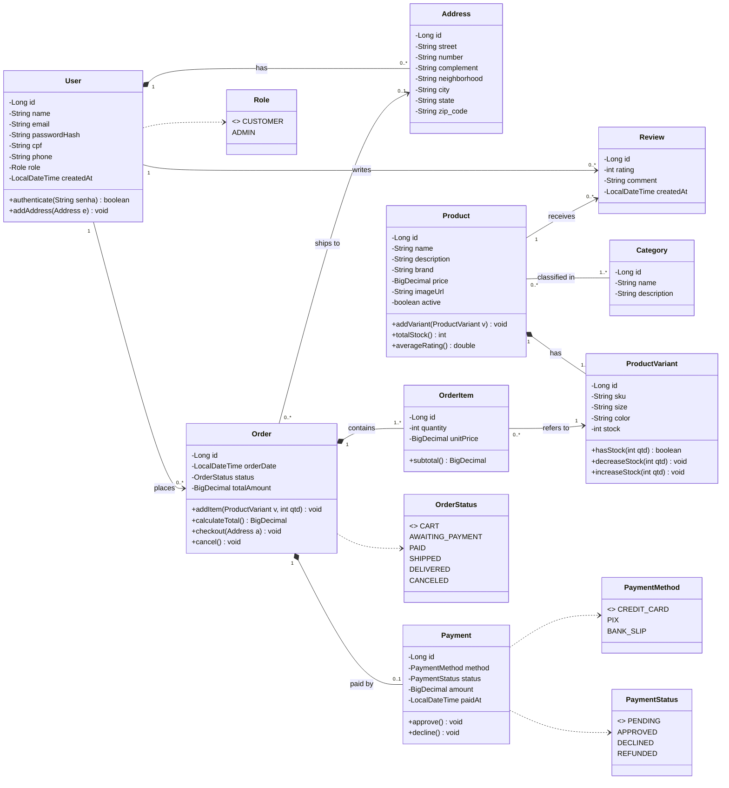

# Documentação – Etapa 1: E-commerce de Roupas

**Equipe:** _(preencher: nomes dos integrantes, líder indicado)_
**Link da aplicação / repositório:** _(preencher)_

---

## 1. Visão Geral do Projeto

### 1.1 Nome do Produto

**ModaShop** – plataforma de e-commerce de roupas (API REST em Java/Spring Boot).

### 1.2 Declaração do Problema e Justificativa

Pequenas e médias lojas de roupas dependem de vendas presenciais ou de redes sociais, onde o controle de estoque, de pedidos e de pagamentos é manual e sujeito a erros. Produtos de vestuário têm uma particularidade: o mesmo item existe em várias combinações de **tamanho e cor**, cada uma com estoque próprio. Isso torna planilhas e controles informais pouco confiáveis e gera vendas de itens indisponíveis.

O ModaShop centraliza catálogo, estoque por variação, carrinho, pedidos e pagamentos em uma API REST, que pode alimentar um site ou aplicativo móvel.

### 1.3 Público-Alvo e Objetivos do Sistema

**Público-alvo**
- **Clientes:** pessoas que compram roupas online e querem navegar pelo catálogo, escolher tamanho e cor, e acompanhar pedidos.
- **Administradores (lojistas):** responsáveis por cadastrar produtos, controlar estoque e gerenciar pedidos.

**Objetivo geral:** disponibilizar uma loja virtual de roupas com catálogo, carrinho, pedido e pagamento, com controle de estoque por tamanho e cor.

**Objetivos específicos**
- Cadastrar e consultar produtos organizados por categorias.
- Controlar o estoque de cada variação (tamanho + cor).
- Permitir que o cliente monte um carrinho e finalize o pedido.
- Registrar o pagamento e o status de cada pedido.
- Permitir que clientes avaliem os produtos comprados.

---

## 2. Especificação de Requisitos

### 2.1 Requisitos Funcionais

| ID | Requisito | Descrição |
|----|-----------|-----------|
| RF01 | Autenticação de usuários | O sistema deve permitir login com e-mail e senha, e identificar o perfil (CUSTOMER ou ADMIN). |
| RF02 | Cadastro de clientes | O visitante deve poder criar uma conta informando nome, e-mail, CPF, telefone e senha. O e-mail e o CPF devem ser únicos. |
| RF03 | Gerenciamento de endereços | O cliente deve poder cadastrar, editar e remover seus endereços de entrega. |
| RF04 | Gerenciamento de categorias | O administrador deve poder criar, editar, listar e excluir categorias (ex.: Camisetas, Calças, Vestidos). |
| RF05 | Gerenciamento de produtos | O administrador deve poder cadastrar, editar, ativar/desativar e excluir produtos, associando-os a uma ou mais categorias. |
| RF06 | Gerenciamento de variações e estoque | O administrador deve poder cadastrar variações de um produto (tamanho, cor, SKU) e controlar a quantidade em estoque de cada uma. |
| RF07 | Consulta ao catálogo | Qualquer usuário deve poder listar produtos ativos, buscar por nome e filtrar por categoria. |
| RF08 | Carrinho de compras | O cliente deve poder adicionar, alterar a quantidade e remover itens (variações) do carrinho. O sistema deve impedir quantidade maior que o estoque. |
| RF09 | Finalização de pedido | O cliente deve poder transformar o carrinho em pedido, escolhendo o endereço de entrega. O preço unitário deve ser gravado no momento da compra. |
| RF10 | Pagamento | O sistema deve registrar o pagamento do pedido por cartão de crédito, PIX ou boleto, com status (PENDING, APPROVED, DECLINED, REFUNDED). |
| RF11 | Acompanhamento de pedidos | O cliente deve poder consultar seus pedidos e o status (AWAITING_PAYMENT, PAID, SHIPPED, DELIVERED, CANCELED). |
| RF12 | Gestão de pedidos | O administrador deve poder listar todos os pedidos e atualizar o status. |
| RF13 | Baixa de estoque | Ao confirmar o pagamento, o sistema deve descontar do estoque as quantidades dos itens. Em caso de cancelamento, deve devolvê-las. |
| RF14 | Avaliação de produtos | O cliente autenticado deve poder avaliar um produto com nota de 1 a 5 e comentário, e qualquer usuário deve poder ver as avaliações. |

### 2.2 Requisitos Não Funcionais

| ID | Categoria | Descrição |
|----|-----------|-----------|
| RNF01 | Padrão REST | A API deve seguir o padrão REST: recursos em substantivos no plural (`/products`), verbos HTTP corretos (GET, POST, PUT, DELETE) e códigos de status adequados (200, 201, 204, 400, 401, 403, 404, 409). |
| RNF02 | Formato de dados | Requisições e respostas devem usar JSON codificado em UTF-8. |
| RNF03 | Segurança – senhas | As senhas devem ser armazenadas com hash (BCrypt); nunca em texto puro nem retornadas pela API. |
| RNF04 | Segurança – autenticação | O acesso a recursos protegidos deve exigir autenticação por token (JWT), com autorização por perfil. |
| RNF05 | Segurança – transporte | Em produção, toda comunicação deve ocorrer via HTTPS. |
| RNF06 | Validação | Os dados de entrada devem ser validados (Bean Validation) e erros devem retornar mensagens padronizadas. |
| RNF07 | Persistência | Os dados devem ser persistidos em banco relacional via JPA/Hibernate, com repositórios Spring Data JPA. PostgreSQL em produção e H2 em desenvolvimento. |
| RNF08 | Integridade | O banco deve usar chaves primárias e estrangeiras, restrições de unicidade (e-mail, CPF, SKU) e valores monetários em `DECIMAL`/`BigDecimal`. |
| RNF09 | Desempenho | Consultas de listagem devem usar paginação; 95% das requisições devem responder em até 1 segundo sob carga normal. |
| RNF10 | Transações | Operações que alteram pedido e estoque devem ser transacionais (`@Transactional`) para evitar inconsistências. |
| RNF11 | Manutenibilidade | O código deve seguir arquitetura em camadas (controller, service, repository, model) e Java 17 + Spring Boot 3. |

---

## 3. Arquitetura e Modelagem de Dados

### 3.1 Diagrama de Classes UML



**Relacionamentos e cardinalidades**

| Relacionamento | Tipo | Cardinalidade | Observação |
|----------------|------|---------------|------------|
| User – Address | 1:N (composição) | 1 → 0..* | Endereços são removidos com o usuário. |
| User – Order | 1:N | 1 → 0..* | |
| User – Review | 1:N | 1 → 0..* | |
| Product – Review | 1:N | 1 → 0..* | |
| Product – Category | **N:M** | 0..* ↔ 1..* | Tabela associativa `product_category`. |
| Product – ProductVariant | 1:N (composição) | 1 → 1..* | Cada variação é um tamanho + cor com estoque próprio. |
| Order – OrderItem | 1:N (composição) | 1 → 1..* | |
| OrderItem – ProductVariant | N:1 | 0..* → 1 | |
| Order – Address | N:1 | 0..* → 0..1 | Endereço de entrega (nulo enquanto for carrinho). |
| Order – Payment | **1:1** | 1 ↔ 0..1 | O pagamento só existe após a finalização. |

> Os métodos listados no diagrama indicam as responsabilidades principais do domínio. Nesta etapa, as classes implementam o mapeamento de persistência; a lógica de negócio é implementada na Etapa 2, na camada de serviço.

### 3.2 Mapeamento de Entidades JPA e Dicionário de Dados

O projeto possui **9 entidades** (`@Entity`) no pacote `com.modashop.ecommerce.entity` e **9 repositórios** (`JpaRepository`) no pacote `com.modashop.ecommerce.repository`.

| Entidade | Tabela | Relacionamentos JPA | Repositório |
|----------|--------|---------------------|-------------|
| User | `users` | `@OneToMany` Address, Order, Review | UserRepository |
| Address | `addresses` | `@ManyToOne` User | AddressRepository |
| Category | `categories` | `@ManyToMany(mappedBy)` Product | CategoryRepository |
| Product | `products` | `@ManyToMany` Category; `@OneToMany` ProductVariant, Review | ProductRepository |
| ProductVariant | `product_variants` | `@ManyToOne` Product | ProductVariantRepository |
| Order | `orders` | `@ManyToOne` User, Address; `@OneToMany` OrderItem; `@OneToOne(mappedBy)` Payment | OrderRepository |
| OrderItem | `order_items` | `@ManyToOne` Order, ProductVariant | OrderItemRepository |
| Payment | `payments` | `@OneToOne` Order | PaymentRepository |
| Review | `reviews` | `@ManyToOne` User, Product | ReviewRepository |

Decisões de mapeamento: todos os `@ManyToOne`/`@OneToOne` usam `FetchType.LAZY`; enums usam `@Enumerated(EnumType.STRING)`; valores monetários usam `BigDecimal` com `precision`/`scale`; o carrinho é um `Order` com status `CART`, o que evita uma entidade duplicada.

#### Dicionário de dados

**users**

| Coluna | Tipo | Restrições |
|--------|------|-----------|
| id | BIGINT | PK, auto incremento |
| name | VARCHAR(120) | NOT NULL |
| email | VARCHAR(150) | NOT NULL, UNIQUE |
| password_hash | VARCHAR(255) | NOT NULL |
| cpf | VARCHAR(11) | UNIQUE |
| phone | VARCHAR(20) | |
| role | VARCHAR(255) | NOT NULL (CUSTOMER, ADMIN) |
| created_at | TIMESTAMP | NOT NULL |

**addresses**

| Coluna | Tipo | Restrições |
|--------|------|-----------|
| id | BIGINT | PK |
| street | VARCHAR(255) | NOT NULL |
| number | VARCHAR(10) | NOT NULL |
| complement | VARCHAR(255) | |
| neighborhood | VARCHAR(80) | NOT NULL |
| city | VARCHAR(80) | NOT NULL |
| state | VARCHAR(2) | NOT NULL |
| zip_code | VARCHAR(8) | NOT NULL |
| user_id | BIGINT | FK → users.id, NOT NULL |

**categories**

| Coluna | Tipo | Restrições |
|--------|------|-----------|
| id | BIGINT | PK |
| name | VARCHAR(80) | NOT NULL, UNIQUE |
| description | VARCHAR(255) | |

**products**

| Coluna | Tipo | Restrições |
|--------|------|-----------|
| id | BIGINT | PK |
| name | VARCHAR(150) | NOT NULL |
| description | VARCHAR(2000) | |
| brand | VARCHAR(80) | |
| price | DECIMAL(10,2) | NOT NULL |
| image_url | VARCHAR(255) | |
| active | BOOLEAN | NOT NULL, padrão true |

**product_category** (tabela associativa N:M)

| Coluna | Tipo | Restrições |
|--------|------|-----------|
| product_id | BIGINT | PK composta, FK → products.id |
| category_id | BIGINT | PK composta, FK → categories.id |

**product_variants**

| Coluna | Tipo | Restrições |
|--------|------|-----------|
| id | BIGINT | PK |
| sku | VARCHAR(50) | NOT NULL, UNIQUE |
| size | VARCHAR(10) | NOT NULL |
| color | VARCHAR(30) | NOT NULL |
| stock | INT | NOT NULL |
| product_id | BIGINT | FK → products.id, NOT NULL; UNIQUE (product_id, size, color) |

**orders**

| Coluna | Tipo | Restrições |
|--------|------|-----------|
| id | BIGINT | PK |
| order_date | TIMESTAMP | NOT NULL |
| status | VARCHAR(255) | NOT NULL (CART, AWAITING_PAYMENT, PAID, SHIPPED, DELIVERED, CANCELED) |
| total_amount | DECIMAL(12,2) | NOT NULL |
| user_id | BIGINT | FK → users.id, NOT NULL |
| shipping_address_id | BIGINT | FK → addresses.id |

**order_items**

| Coluna | Tipo | Restrições |
|--------|------|-----------|
| id | BIGINT | PK |
| quantity | INT | NOT NULL |
| unit_price | DECIMAL(10,2) | NOT NULL |
| order_id | BIGINT | FK → orders.id, NOT NULL |
| variant_id | BIGINT | FK → product_variants.id, NOT NULL |

**payments**

| Coluna | Tipo | Restrições |
|--------|------|-----------|
| id | BIGINT | PK |
| method | VARCHAR(255) | NOT NULL (CREDIT_CARD, PIX, BANK_SLIP) |
| status | VARCHAR(255) | NOT NULL (PENDING, APPROVED, DECLINED, REFUNDED) |
| amount | DECIMAL(12,2) | NOT NULL |
| paid_at | TIMESTAMP | |
| order_id | BIGINT | FK → orders.id, NOT NULL, UNIQUE |

**reviews**

| Coluna | Tipo | Restrições |
|--------|------|-----------|
| id | BIGINT | PK |
| rating | INT | NOT NULL (1 a 5) |
| comment | VARCHAR(1000) | |
| created_at | TIMESTAMP | NOT NULL |
| user_id | BIGINT | FK → users.id, NOT NULL |
| product_id | BIGINT | FK → products.id, NOT NULL |

### Como executar

```bash
mvn spring-boot:run
```

Com o role padrão (H2 em memória), o console fica em `http://localhost:8080/h2-console` (JDBC URL `jdbc:h2:mem:modadb`).
